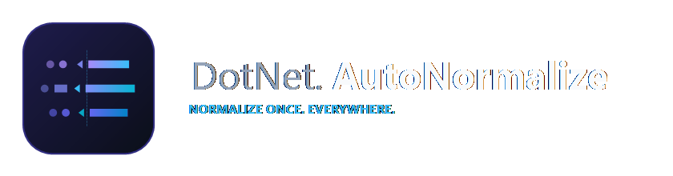
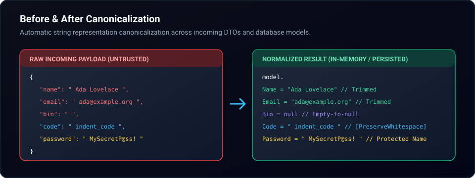
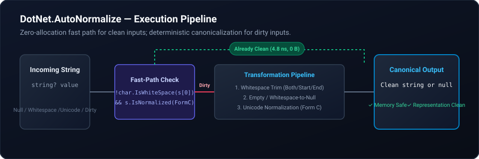
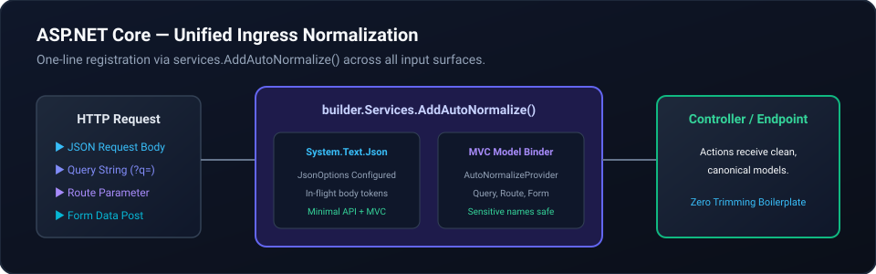
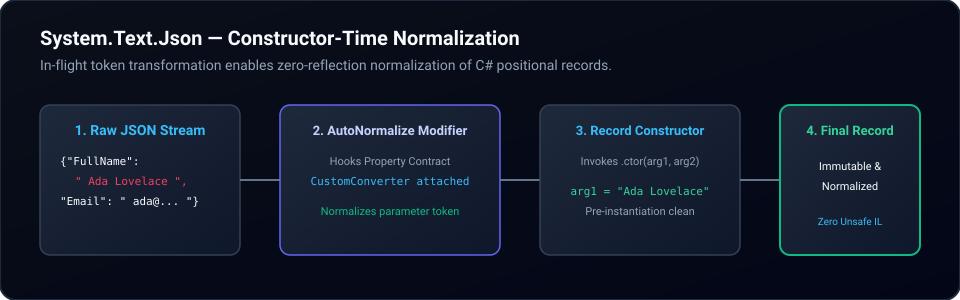
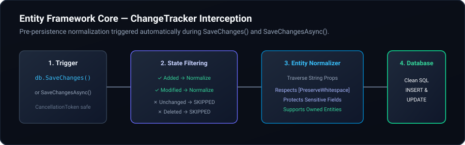

# AutoNormalize



> **Consistent, configurable, safe-by-default input normalization for modern .NET applications.**

[](https://github.com/SkyDevLab/DotNet.AutoNormalize/blob/main/LICENSE)
[](https://dotnet.microsoft.com/)
[](https://www.nuget.org/packages/AutoNormalize.Core/1.0.0-preview.2)
[](https://github.com/SkyDevLab/DotNet.AutoNormalize/blob/main/docs/benchmark-report.md)

---

## 1. Problem Statement

Across ASP.NET Core applications, developers repeatedly write boilerplate logic to canonicalize incoming text data:
- Trimming leading and trailing whitespace from strings.
- Converting empty or whitespace-only strings to `null`.
- Canonicalizing Unicode character sequences into standard Unicode Normalization Form C.
- Enforcing standardized casing rules across DTOs and database models.

When performed manually, normalization is scattered across controllers, validators, or repository layers. This leads to subtle defects:
- Missing `.Trim()` calls causing duplicate database records (e.g. `"user@example.com "` vs `"user@example.com"`).
- Inadvertent mutilation of sensitive fields (such as passwords, tokens, API keys, or Base64 payloads) when naive global string converters are used.
- Accidental mutation crashes on immutable C# positional records.
- Unnecessary managed heap allocations on strings that were already clean.

---

## 2. Why DotNet.AutoNormalize Exists

**DotNet.AutoNormalize** provides representation canonicalization at application ingress and persistence boundaries. It integrates directly with:
- **`System.Text.Json`**: Canonicalizes string tokens *in-flight during deserialization*, binding cleanly into immutable C# positional records before constructor invocation.
- **ASP.NET Core Minimal APIs & MVC**: Normalizes JSON request bodies, query strings, route parameters, and form fields via unified dependency injection.
- **Entity Framework Core**: Hooks `SaveChanges()` via an `ISaveChangesInterceptor`, canonicalizing `Added` and `Modified` entity states prior to database write while skipping unchanged entities.

```
       RAW INPUT                             CANONICAL OUTPUT
┌──────────────────────────┐          ┌──────────────────────────┐
│ Name:     "   Ada   "    │  ──────► │ Name:     "Ada"          │
│ Bio:      "     "        │          │ Bio:      null           │
│ Password: "  secret  "   │          │ Password: "  secret  "   │ (Shielded)
└──────────────────────────┘          └──────────────────────────┘
```



---

## 3. Key Features

- **Zero-Allocation Fast Path**: Clean strings that do not require trimming or Unicode re-encoding bypass allocation, completing in **4.83 nanoseconds** with **0 bytes allocated**.
- **Constructor-Time Record Normalization**: Position records (`public record User(string Name, string Email)`) normalize during JSON deserialization without unsafe IL or reflection mutations.
- **Defense-in-Depth Sensitive Guard**: Built-in heuristic shielding for sensitive property names (`Password`, `Token`, `ApiKey`, `Secret`, `Signature`, `Hash`, `Salt`).
- **Explicit Opt-Out Attributes**: Declarative control via `[PreserveWhitespace]`, `[DoNotNormalize]`, and `[NormalizeWith(typeof(T))]`.
- **Cycle-Safe Object Graphs**: Traverses complex DTO hierarchies with circular reference tracking and configurable recursion limits.
- **Dictionary Safety**: Dictionaries normalize string values only; dictionary keys are never mutated to avoid hash bucket corruption or collisions.

---

## 4. Supported Target Frameworks

| Target Framework | Implementation Tier | Minimum SDK |
| :--- | :--- | :--- |
| **`.NET 9.0`** (STS) | Native multi-target | 9.0.100+ |
| **`.NET 8.0`** (LTS) | Native multi-target | 8.0.100+ |
| **`.NET Standard 2.0`** | `DotNet.AutoNormalize.Abstractions` | Compatible with .NET Framework 4.6.2+ & .NET Core |
| **`.NET 10.0`** | Forward-compatible via NuGet asset resolution | Compatible |

---

## 5. Package Ecosystem & Installation

Install the specific package matching your architectural layer. See the [Installation Guide](https://github.com/SkyDevLab/DotNet.AutoNormalize/blob/main/docs/installation.md) for full package details.

```bash
# Core standalone engine
dotnet add package AutoNormalize.Core

# ASP.NET Core (Minimal APIs, MVC & System.Text.Json)
dotnet add package AutoNormalize.AspNetCore

# Entity Framework Core persistence interceptor
dotnet add package AutoNormalize.EntityFrameworkCore
```

---

## 6. Basic Usage (Standalone Engine)

```csharp
using DotNet.AutoNormalize.Core;
using DotNet.AutoNormalize.Core.Engine;

var options = new AutoNormalizeOptions
{
    TrimStrings = true,
    EmptyStringsToNull = true,
    UnicodeNormalization = System.Text.NormalizationForm.FormC
};

IAutoNormalizer normalizer = new AutoNormalizer(options);

var user = new UserProfile
{
    DisplayName = "   Nikola Tesla   ",
    Bio = "      "
};

normalizer.Normalize(user);

// user.DisplayName == "Nikola Tesla"
// user.Bio == null
```



---

## 7. ASP.NET Core Integration

In your `Program.cs`, call `AddAutoNormalize()` on `builder.Services`:

```csharp
var builder = WebApplication.CreateBuilder(args);

// Configures Minimal APIs, MVC Model Binding, and System.Text.Json
builder.Services.AddAutoNormalize(options =>
{
    options.TrimStrings = true;
    options.EmptyStringsToNull = true;
    options.UnicodeNormalization = NormalizationForm.FormC;
});

var app = builder.Build();

// Positional records normalized at birth during JSON deserialization
app.MapPost("/api/users", (RegisterUserCommand command) =>
{
    return Results.Ok(command);
});

app.Run();

public record RegisterUserCommand(string FullName, string Email);
```



---

## 8. System.Text.Json Integration

When configuring standalone `JsonSerializerOptions`:

```csharp
using System.Text.Json;
using DotNet.AutoNormalize.Json.Extensions;

var options = new JsonSerializerOptions().AddAutoNormalize(opt =>
{
    opt.TrimStrings = true;
    opt.EmptyStringsToNull = true;
});

string json = """{"Name": "   Grace Hopper   ", "Email": "   grace@navy.mil   "}""";
var customer = JsonSerializer.Deserialize<CustomerRecord>(json, options);

// customer.Name == "Grace Hopper"
// customer.Email == "grace@navy.mil"
```



---

## 9. Entity Framework Core Integration

Add the interceptor to your `DbContext`:

```csharp
using Microsoft.EntityFrameworkCore;

builder.Services.AddDbContext<AppDbContext>(options =>
{
    options.UseSqlServer(connectionString)
           .AddAutoNormalize(opt =>
           {
               opt.TrimStrings = true;
               opt.EmptyStringsToNull = true;
           });
});
```



---

## 10. Attributes and Opt-Outs

Fine-tune normalization behavior on individual properties or classes:

```csharp
using DotNet.AutoNormalize.Abstractions;

public class EmployeeRecord
{
    public string Name { get; set; } = string.Empty; // Normalized

    [PreserveWhitespace]
    public string FormattedCode { get; set; } = string.Empty; // Whitespace preserved

    [DoNotNormalize]
    public string RawHash { get; set; } = string.Empty; // Excluded completely

    public string Password { get; set; } = string.Empty; // Protected by sensitive name heuristic
}
```

---

## 11. Custom Normalizers

Implement `IStringNormalizer` to enforce domain-specific rules:

```csharp
public class UppercasePostalCodeNormalizer : IStringNormalizer
{
    public string? Normalize(string? value, NormalizationContext context)
    {
        return value?.Trim().ToUpperInvariant();
    }
}

// Register globally in options:
options.AddNormalizer(new UppercasePostalCodeNormalizer());

// Or attach via attribute:
public class Address
{
    [NormalizeWith(typeof(UppercasePostalCodeNormalizer))]
    public string? PostalCode { get; set; }
}
```

---

## 12. Security Considerations

> [!IMPORTANT]
> **Normalization Boundary Rules**
> 1. **Normalization IS NOT Validation**: Normalization canonicalizes representation. It never asserts business rules, regex formats, or ranges. Use FluentValidation or DataAnnotations for validation.
> 2. **Normalization IS NOT Sanitization**: Normalization does not strip HTML tags or escape script tags. Use dedicated sanitizers for HTML sanitization.
> 3. **Normalization IS NOT SQL Injection Defense**: Always use parameterized queries for SQL injection protection.

### Sensitive Field Protection
By default, properties matching the following names are shielded from trimming and modification:
`Password`, `Passcode`, `Token`, `AuthToken`, `AccessToken`, `RefreshToken`, `Secret`, `ClientSecret`, `SecretKey`, `ApiKey`, `PrivateKey`, `Signature`, `Hash`, `Salt`, `Passphrase`, `Certificate`.

---

## 13. Audited Benchmarks

Tested via **BenchmarkDotNet v0.14.0** on .NET 9.0 (RyuJIT AVX2, Windows 11):

| Workload | Method | Mean Duration | Managed Allocation |
| :--- | :--- | :--- | :--- |
| **Clean String** | `CleanString_AutoNormalize` | **4.83 ns** | **0 B (Zero Allocation)** |
| **Dirty String** | `DirtyString_AutoNormalize` | **17.35 ns** | **112 B** |
| **Whitespace to Null** | `WhitespaceOnly_AutoNormalize` | **12.49 ns** | **0 B** |
| **Decomposed Unicode** | `DecomposedUnicode_AutoNormalize` | **136.37 ns** | **32 B** |
| **Typical DTO (6 props)** | `TypicalDto_AutoNormalize` | **283.55 ns** | **912 B** |
| **JSON Deserialization** | `Deserialize_AutoNormalize` | **601.90 ns** | **952 B** |
| **EF Core SaveChanges** | `SaveChanges_WithAutoNormalize` | **22.23 µs** | **30.95 KB** |

*All microbenchmarks use non-constant runtime inputs (`string.Concat`) to prevent RyuJIT constant-folding. See the [Benchmark Report & Audit](https://github.com/SkyDevLab/DotNet.AutoNormalize/blob/main/docs/benchmark-audit.md).*

---

## 14. Known Limitations

1. **In-Memory Positional Records**: Calling `normalizer.Normalize(record)` on an already-instantiated positional record cannot mutate properties post-construction. Full record normalization occurs during `System.Text.Json` deserialization.
2. **Dictionary Keys**: Dictionaries normalize values only. Keys are never mutated to prevent hashcode invalidation or key collisions.
3. **Read-Only Collections**: In-place normalization cannot mutate `IReadOnlyList<T>` elements and safely skips them.

---

## 15. Documentation Index

- [Installation Guide](https://github.com/SkyDevLab/DotNet.AutoNormalize/blob/main/docs/installation.md)
- [Architecture & Design Proposal](https://github.com/SkyDevLab/DotNet.AutoNormalize/blob/main/docs/api-design-proposal.md)
- [Security Model & Boundaries](https://github.com/SkyDevLab/DotNet.AutoNormalize/blob/main/docs/security-model.md)
- [Benchmark Report & Audit](https://github.com/SkyDevLab/DotNet.AutoNormalize/blob/main/docs/benchmark-audit.md)
- [.NET 10 Evaluation](https://github.com/SkyDevLab/DotNet.AutoNormalize/blob/main/docs/dotnet10-evaluation.md)
- [Release Engineering & Pipeline](https://github.com/SkyDevLab/DotNet.AutoNormalize/blob/main/docs/release-engineering.md)

---

## 16. Contributing & Community

Contributions are welcome! Please review [CONTRIBUTING.md](https://github.com/SkyDevLab/DotNet.AutoNormalize/blob/main/CONTRIBUTING.md) and [SECURITY.md](https://github.com/SkyDevLab/DotNet.AutoNormalize/blob/main/SECURITY.md) before opening a pull request or submitting a report.

---

## 17. License

Distributed under the [MIT License](https://github.com/SkyDevLab/DotNet.AutoNormalize/blob/main/LICENSE). Copyright © DotNet.AutoNormalize Contributors.
