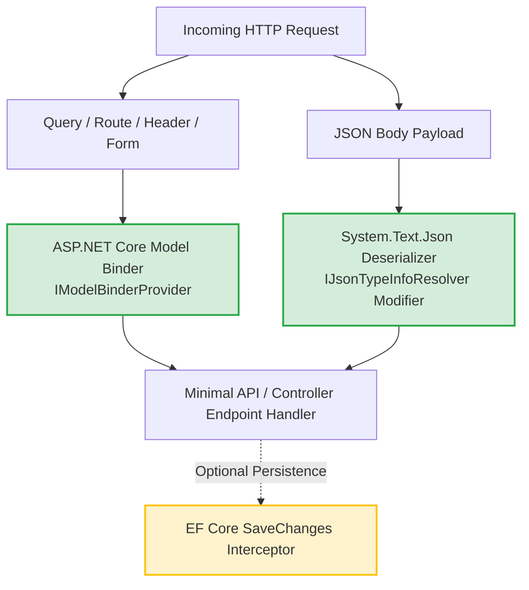

# Architecture Review: DotNet.AutoNormalize

## 1. Executive Summary & Purpose of Review

The initial Phase 1 research proposed a broad multi-package architecture featuring expression-tree compilation, multi-layer web filters, and naming-based security heuristics.

This review performs a critical, uncompromising architectural audit of that design. It asks:
* What is genuinely necessary versus what introduces accidental complexity, performance penalties, or redundant execution?
* Where do existing integration mechanisms conflict or duplicate effort?
* How can the library achieve rock-solid correctness, safety, and maintainability without over-engineering?

---

## 2. Critical Evaluation of Integration Mechanisms

An ASP.NET Core request passes through multiple middleware, binding, and deserialization phases. Applying normalization indiscriminately across every layer leads to duplicate object graph traversals and performance degradation.



### 2.1 The Two Primary Ingress Boundaries

| Ingress Channel | Transport Format | Canonical Integration Point | Assessment |
| :--- | :--- | :--- | :--- |
| **HTTP Request Body** | JSON (`application/json`) | `System.Text.Json` via `IJsonTypeInfoResolver` modifier | **Essential & Optimal**: Handles both Minimal APIs and MVC `[FromBody]` during deserialization. Strings are normalized as properties are assigned. Zero duplicate traversal. |
| **HTTP Parameters** | Route values, Query string, Form data, Headers | ASP.NET Core `IModelBinderProvider` | **Essential & Optimal**: Normalizes scalar string inputs before they reach controller actions or Minimal API parameters. |

### 2.2 Re-Evaluating Redundant Integrations

#### A. Minimal API `IEndpointFilter`
* **Analysis**: In Minimal APIs, JSON payloads are deserialized by `System.Text.Json`. If the JSON deserializer already normalizes properties during instantiation, running an `IEndpointFilter` over the incoming arguments causes an unnecessary second traversal of the entire object graph.
* **Verdict**: **Redundant for JSON bodies**. An endpoint filter should only be used as a fallback if JSON contract customization is unavailable or for ad-hoc non-bound parameter normalization. By configuring `JsonOptions.SerializerOptions.TypeInfoResolver`, Minimal APIs get automatic, zero-redundancy normalization for all JSON requests.

#### B. Global Scalar `JsonConverter<string>`
* **Analysis**: A global `JsonConverter<string>` intercepts every string token at the raw JSON reader level. It possesses **zero awareness** of the enclosing class or property metadata.
* **Verdict**: **Rejected on Architectural & Security Grounds**. It cannot inspect `[PreserveWhitespace]` or `[DoNotNormalize]` attributes and will corrupt sensitive fields (passwords, base64 strings, cryptographic hashes).

#### C. In-Memory Graph Traversal via Compiled Expression Trees
* **Analysis**: Compiling dynamic expression trees (`Expression.Compile()`) incurs heavy cold-start compilation overhead and breaks Native AOT compilation. For the primary web path (JSON deserialization), `System.Text.Json` already uses optimized delegates. For standalone in-memory normalization, cached reflection delegates or property accessors provide near-identical throughput without dynamic code generation.
* **Verdict**: **Deferred / Simplified**. Do not introduce runtime expression compilation in v1.0. Start with cached reflection metadata and optimize based on concrete benchmarks.

#### D. EF Core `ISaveChangesInterceptor`
* **Analysis**: Data entering an application via non-HTTP sources (background queues, batch imports, direct service calls) bypasses ASP.NET Core model binding. An EF Core interceptor normalizes entities at the persistence boundary.
* **Verdict**: **Genuinely Useful, but Isolated**. Must reside in a distinct package (`DotNet.AutoNormalize.EntityFrameworkCore`) so applications that do not use EF Core are not burdened with its heavy assembly dependencies.

---

## 3. Handling C# Records, Immutability, and Init-Only Properties

### 3.1 The Problem with Post-Deserialization Mutation
C# 9+ introduced positional records and init-only (`init;`) properties:
```csharp
public sealed record RegisterUserCommand(string Username, string Email);
```
Once instantiated, these properties cannot be mutated. Post-construction reflection (`PropertyInfo.SetValue`) throws an exception on init-only properties or violates runtime immutability.

### 3.2 The Architectural Solution: Ingress-Time Normalization
By placing normalization inside the `System.Text.Json` deserialization pipeline via `IJsonTypeInfoResolver`:
1. `System.Text.Json` resolves constructor arguments and property setters *during* deserialization.
2. The custom modifier wraps property/parameter setters so that values are normalized **before** the object or record is materialized.
3. Positional records, init-only properties, and standard mutable classes are all populated with normalized strings at creation time.

For standalone in-memory normalization (`IAutoNormalizer.Normalize<T>()`):
* Mutable types are modified in place.
* Read-only or init-only properties are safely skipped with a diagnostic warning rather than throwing runtime exceptions.

---

## 4. Object Graph Traversal & Cycle Protection

When normalizing arbitrary object graphs outside JSON deserialization (e.g., in service layers or domain logic):
1. **Cycle Detection**: The traverser must maintain a reference set (`HashSet<object>(ReferenceEqualityComparer.Instance)`) of visited reference-type objects. If an object is re-encountered, traversal aborts the branch.
2. **Depth Limiting**: A strict `MaxRecursionDepth` guard (default: 32) prevents deep recursion or stack overflow on maliciously constructed or self-referential payloads.
3. **Ignored Types**: System types, primitives, value types, delegates, streams, and types in `System.*` namespaces (except collections/dictionaries) are excluded from reflection traversal.

---

## 5. Architectural Conclusions & Scope Adjustments

1. **Keep Core Simple & Dependency-Free**:
   * `DotNet.AutoNormalize.Abstractions`: Zero dependencies (`netstandard2.0;net8.0;net9.0`).
   * `DotNet.AutoNormalize.Core`: Pure .NET standard logic; no web dependencies.
2. **Unify Web Integration through Modern Extension Points**:
   * Integrate JSON normalization via `System.Text.Json` TypeInfo resolver modifier.
   * Integrate parameter normalization via MVC `IModelBinderProvider`.
   * A single call to `services.AddAutoNormalize()` configures both transparently.
3. **Reject Unjustified Complexity**:
   * Do not introduce runtime expression compilation before benchmarking.
   * Do not double-traverse requests with unnecessary Minimal API filters.
   * Isolate EF Core into an optional satellite package.
