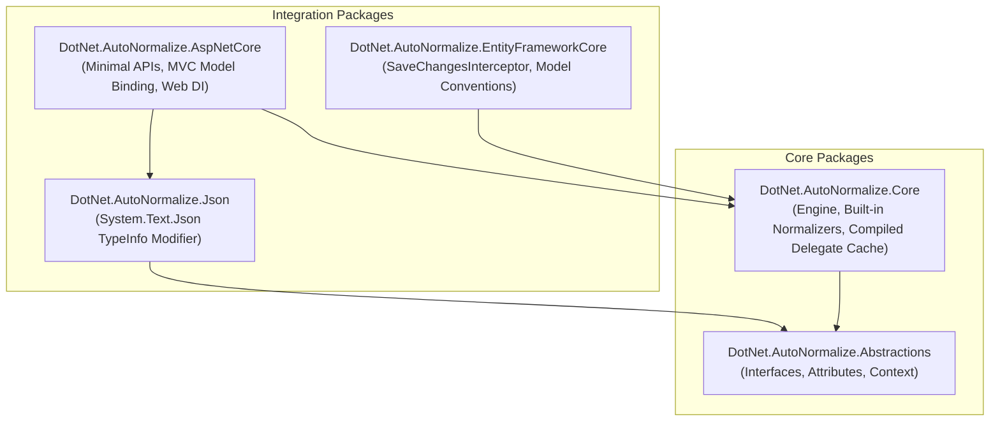
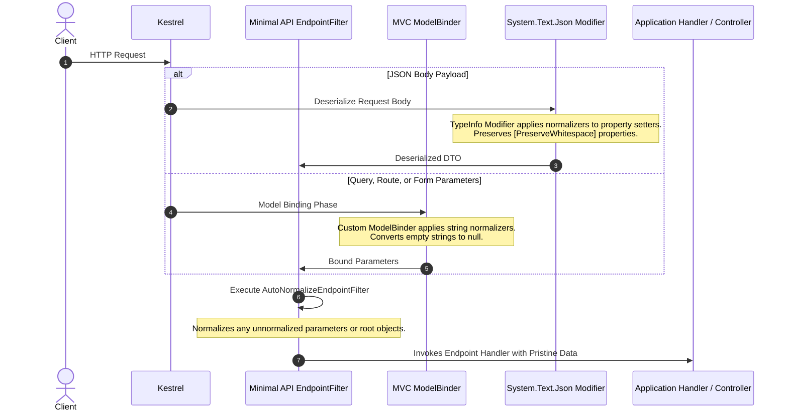

# Architectural Blueprint: DotNet.AutoNormalize

## 1. System Overview & Package Decomposition

`DotNet.AutoNormalize` follows the Dependency Inversion Principle, clean separation of concerns, and minimal dependency overhead. The library is decomposed into focused, single-purpose packages to avoid coupling core domain normalization logic to ASP.NET Core or third-party web frameworks.



### Package Responsibilities

| Package | Dependencies | Target Frameworks | Responsibilities |
| :--- | :--- | :--- | :--- |
| **`DotNet.AutoNormalize.Abstractions`** | None | `netstandard2.0;net8.0;net9.0` | Core interfaces (`INormalizer<T>`, `IAutoNormalizer`), normalization context, attributes (`[PreserveWhitespace]`, `[DoNotNormalize]`, `[NormalizeWith]`), configuration contracts. |
| **`DotNet.AutoNormalize.Core`** | `DotNet.AutoNormalize.Abstractions` | `net8.0;net9.0` | Standard normalization rules (Trim, Unicode, Empty-to-Null), object graph visitor, expression-tree delegate compiler, reflection metadata cache, cycle detector. |
| **`DotNet.AutoNormalize.Json`** | `DotNet.AutoNormalize.Abstractions` | `net8.0;net9.0` | Metadata-aware `IJsonTypeInfoResolver` modifier for `System.Text.Json`, enabling zero-overhead normalization during JSON deserialization without mutating sensitive properties. |
| **`DotNet.AutoNormalize.AspNetCore`** | `DotNet.AutoNormalize.Core`, `DotNet.AutoNormalize.Json` | `net8.0;net9.0` | Unified DI extension `AddAutoNormalize()`, Minimal API `IEndpointFilter` auto-registration, MVC `IModelBinderProvider` for Query/Route/Form parameters. |
| **`DotNet.AutoNormalize.EntityFrameworkCore`** | `DotNet.AutoNormalize.Core` | `net8.0;net9.0` | Optional EF Core `ISaveChangesInterceptor` and `ModelConfigurationBuilder` conventions for database-layer persistence normalization. |

---

## 2. Core Abstractions & Normalization Pipeline

### 2.1 The Normalizer Contract
The fundamental building block is `INormalizer<T>`, allowing composable, strongly-typed normalization operations:

```csharp
namespace DotNet.AutoNormalize.Abstractions;

public interface INormalizer<T>
{
    T Normalize(T value, NormalizationContext context);
}
```

A specialized string normalizer contract simplifies string-centric operations:

```csharp
public interface IStringNormalizer : INormalizer<string?>
{
}
```

### 2.2 Normalization Context
`NormalizationContext` provides operational metadata, enabling normalizers to make context-aware decisions:
* Property name and `PropertyInfo` (if operating on an object property).
* Declaring type and target type.
* Applied custom attributes.
* Access to the configured `IServiceProvider` (for resolving dependencies in custom normalizers).
* Custom state dictionary.

---

## 3. High-Performance Graph Traversal & Delegate Compilation

### 3.1 Avoiding Reflection Overhead
Naive reflection (`PropertyInfo.GetValue` / `SetValue`) introduces prohibitive overhead on web request hot paths. `DotNet.AutoNormalize.Core` implements a two-tier execution strategy:

1. **Cold Path (Type Discovery & Compilation)**:
   * When a type `T` is first encountered, the engine inspects its properties.
   * Properties are filtered against sensitive naming heuristics and opt-out attributes (`[PreserveWhitespace]`, `[DoNotNormalize]`).
   * For each eligible property, the engine constructs a compiled expression tree:
     ```csharp
     // Compiled into Action<object, NormalizationContext>
     (target, ctx) => ((MyDto)target).Name = normalizer.Normalize(((MyDto)target).Name, ctx);
     ```
   * The compiled plan is cached in a thread-safe `ConcurrentDictionary<Type, ObjectNormalizationPlan>`.

2. **Hot Path (Execution)**:
   * The cached `ObjectNormalizationPlan` is retrieved via atomic lookup.
   * Normalization delegates execute at raw compiled method-call speed with zero reflection invocations.
   * If a string is already clean (e.g., `string.IsNormalized()` is true, and no whitespace to trim), the exact same string instance is preserved without new string allocations.

### 3.2 Graph Traversal & Cycle Detection
Real-world DTOs can contain self-referencing navigation properties or circular graphs.
* The visitor maintains a `HashSet<object>(ReferenceEqualityComparer.Instance)` during traversal.
* If an object reference is already present in the active visited set, the traversal skips it immediately, preventing `StackOverflowException`.
* Configurable recursion depth limit (default: 32 levels) provides deterministic bounding against malicious payloads.

### 3.3 Handling Immutability, C# Records, and Init-Only Properties
C# records and init-only properties cannot be modified via property setters once constructed:
* **JSON Deserialization Phase**: In modern `System.Text.Json` (.NET 8/9), the `DotNet.AutoNormalize.Json` modifier intercepts deserialization at the property setter or parameter binding stage, ensuring records are constructed directly with normalized values.
* **In-Memory Traversal Phase**: For immutable records already instantiated in memory, the engine provides copy-on-normalize semantics via reflection/constructor matching or recomposition, while mutable classes are updated in-place.

---

## 4. ASP.NET Core Multi-Boundary Pipeline

Normalization is applied consistently across all incoming transport boundaries in ASP.NET Core:



---

## 5. Security & Sensitive Property Heuristics

`DotNet.AutoNormalize` implements strict **Safe-by-Default** policies:

### 5.1 Automatic Property Name Filtering
By default, any property whose name matches or ends with any of the following standard sensitive tokens is excluded from normalization unless explicitly annotated to override:
* `Password`, `Passcode`, `Hash`, `Salt`
* `Token`, `AuthToken`, `AccessToken`, `RefreshToken`, `IdToken`
* `Secret`, `ClientSecret`, `ApiKey`, `PrivateKey`
* `Signature`, `Cert`, `Certificate`
* `Base64`, `Raw`

### 5.2 Attribute Protections
* `[PreserveWhitespace]`: Prevents trimming, preserving leading and trailing spaces.
* `[DoNotNormalize]`: Completely excludes the decorated property or class from all normalization rules.
* `[DataType(DataType.Password)]`: Automatically recognized from `System.ComponentModel.DataAnnotations`.
