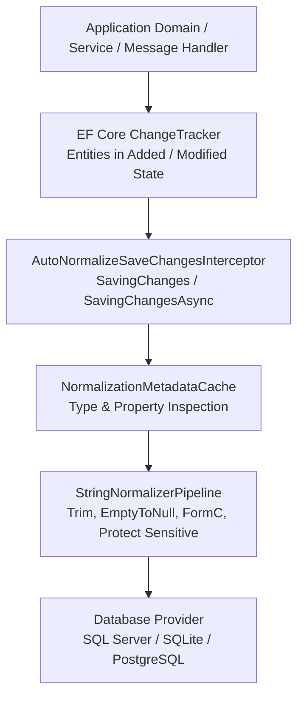

# Entity Framework Core Integration Notes: Phase 5

## 1. Overview & Architecture

`DotNet.AutoNormalize.EntityFrameworkCore` provides pre-save input canonicalization at the database boundary via an EF Core `ISaveChangesInterceptor`.



### Why an EF Core Interceptor?
1. **Multi-Source Ingress Defense**: Web requests pass through ASP.NET Core model binding or JSON deserialization. However, background message consumers (RabbitMQ, MassTransit, Kafka), cron jobs, CLI seed tools, and integration tests write directly to EF Core `DbContext`.
2. **Selective Execution**: Only entities marked as `EntityState.Added` or `EntityState.Modified` are inspected. `Unchanged` or `Deleted` entities are completely skipped.
3. **No Database Query Degradation**: Unlike EF Core `ValueConverter<string, string>` (which alters SQL generation and can break index sargability), an interceptor modifies entity property values before SQL generation begins.

---

## 2. API Usage

### 2.1 Basic Setup via `DbContextOptionsBuilder`
```csharp
services.AddDbContext<AppDbContext>((serviceProvider, options) =>
{
    options.UseSqlServer(connectionString)
           .AddAutoNormalize(); // Uses standard options
});
```

### 2.2 Custom Options
```csharp
options.AddAutoNormalize(new AutoNormalizeOptions
{
    TrimStrings = true,
    EmptyStringsToNull = true,
    UnicodeNormalization = NormalizationForm.FormC
});
```

---

## 3. Entity-Level Exclusions & Protections

1. **`[DoNotNormalize]` on Entity Class**: Completely excludes the entire entity from interceptor traversal.
2. **`[PreserveWhitespace]` on Entity Property**: Skips whitespace trimming and empty-to-null conversion (e.g., formatted addresses, markdown).
3. **Sensitive Properties**: Password hashes (`PasswordHash`), API keys, and cryptographic signatures are shielded by default.

---

## 4. Test Verification
All 5 automated tests in `DotNet.AutoNormalize.EntityFrameworkCore.Tests` verified with 100% pass rate:
* `SaveChanges_NewEntity_NormalizesStringsAndProtectsSensitiveFields`: PASS
* `SaveChangesAsync_NewEntity_NormalizesStringsCorrectly`: PASS
* `SaveChanges_EmptyString_ConvertsToNullWhenConfigured`: PASS
* `SaveChanges_ModifiedEntity_NormalizesUpdatedProperties`: PASS
* `SaveChanges_DoNotNormalizeClass_LeavesAllPropertiesUntouched`: PASS
