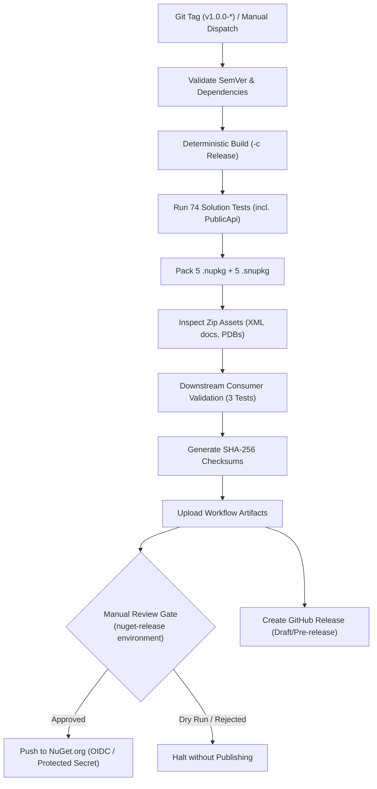

# Release Engineering & Pipeline Architecture

## 1. Principles of Release Engineering

`DotNet.AutoNormalize` follows release principles consistent with premier open-source libraries:
1. **Zero Secret Exposure**: Build and pull-request workflows run with read-only permissions and zero access to publishing credentials.
2. **Deterministic & Reproducible Builds**: Packages are built with `<Deterministic>true</Deterministic>` and `-p:ContinuousIntegrationBuild=true`, ensuring identical binary artifacts regardless of build environment.
3. **Multi-Stage Validation**: Every release candidate passes through compilation, unit tests, public API approval tests, sample execution, package artifact inspection, and independent package consumer validation before any publication gate.
4. **Protected Environment Approval**: Publishing to NuGet.org is gated behind GitHub Environment protection rules requiring explicit maintainer review.

---

## 2. Release Pipeline Architecture



---

## 3. Supply-Chain Security Controls

### 3.1 Pinned GitHub Actions
All GitHub Actions in `.github/workflows/release.yml` and `.github/workflows/docs.yml` are pinned to immutable, full-length commit SHAs with semantic version comments. This prevents automated supply-chain compromise via mutable tag reassignment.

### 3.2 Vulnerability Scanning
The pipeline executes:
```bash
dotnet list package --vulnerable --include-transitive
```
This fails the release job if any dependency or transitive dependency contains a known CVE in the GitHub Advisory Database.

### 3.3 Least-Privilege Permissions
- Workflow default permissions are set to `permissions: contents: read`.
- Elevated write permissions (`contents: write` or `pages: write`) are scoped strictly to individual jobs that require them (`publish-github-release` and `deploy-docs`).

### 3.4 Package Integrity Verification
Every build computes and publishes `checksums.sha256` containing SHA-256 digests of all generated `.nupkg` and `.snupkg` files.

---

## 4. NuGet Publishing Protocol

### 4.1 Preferred Authentication: Trusted Signing & OIDC
Where supported by NuGet.org and GitHub repository organization configuration, OIDC Trusted Signing allows publishing without storing static API keys.

### 4.2 Protected Secrets Alternative
When using static API keys:
- The secret `NUGET_API_KEY` is stored strictly within the protected `nuget-release` GitHub Environment.
- Only users with Maintainer permissions can approve deployments to `nuget-release`.
- Pull requests and branch builds have zero access to the secret.

---

## 5. Documentation Pipeline (`.github/workflows/docs.yml`)

The documentation pipeline runs independently from package release:
- Triggers on documentation changes (`docs/**`, `README.md`) on `main`.
- Verifies internal file links and structure.
- Builds static content for GitHub Pages and deploys via `actions/deploy-pages`.
