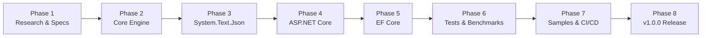

# Project Roadmap: DotNet.AutoNormalize

## 1. Overview & Phased Strategy

`DotNet.AutoNormalize` follows an incremental, disciplined delivery lifecycle. Each phase delivers a functional, tested increment with clear architectural validation and regression prevention.

---

## 2. Detailed Milestone Breakdown

### Phase 1: Research, Competitive Analysis & Architectural RFCs (Current)
* [x] Conduct deep research into existing solutions (`Samhammer`, `DimonSmart`, bespoke JSON converters, EF Core interceptors).
* [x] Identify critical industry gaps (absence of unified abstraction, unsafe password trimming, lack of Minimal API support).
* [x] Produce foundation documentation:
  * `docs/competitive-analysis.md`
  * `docs/product-vision.md`
  * `docs/architecture.md`
  * `docs/roadmap.md`

### Phase 2: Core Abstractions & High-Performance Engine
* [ ] **`DotNet.AutoNormalize.Abstractions`**:
  * Define `INormalizer<T>`, `IStringNormalizer`, and `IAutoNormalizer`.
  * Define `NormalizationContext` with property metadata and dependency resolution context.
  * Define core attributes: `[PreserveWhitespace]`, `[DoNotNormalize]`, `[NormalizeWith]`, `[NormalizeRule]`.
  * Support multi-targeting (`netstandard2.0`, `net8.0`, `net9.0`).
* [ ] **`DotNet.AutoNormalize.Core`**:
  * Built-in string normalizers: `TrimNormalizer`, `EmptyStringToNullNormalizer`, `NullToEmptyStringNormalizer`, `UnicodeNormalizer` (Form C, Form D, Form KC, Form KD), `CasingNormalizer`.
  * High-performance `ObjectGraphNormalizer` with expression-tree compilation and `ConcurrentDictionary` caching.
  * Sensitive property heuristic guard (ignoring passwords, secrets, API keys, tokens).
  * Cycle detection with `ReferenceEqualityComparer` and recursion depth guards.
  * Array, `List<T>`, `IEnumerable<T>`, and `Dictionary<TKey, TValue>` traversal support.
  * Comprehensive xUnit test suite for Core.

### Phase 3: System.Text.Json Integration
* [ ] **`DotNet.AutoNormalize.Json`**:
  * Implement metadata-aware `IJsonTypeInfoResolver` modifier for `System.Text.Json`.
  * Intercept property deserialization without token-level side effects.
  * Respect property-level attributes (`[PreserveWhitespace]`, `[NormalizeWith]`, `[DoNotNormalize]`).
  * Ensure full compatibility with C# 9+ records and init-only (`init;`) properties during JSON deserialization.
  * Unit tests validating JSON payload deserialization across standard, record, and sensitive models.

### Phase 4: ASP.NET Core Web Integration
* [ ] **`DotNet.AutoNormalize.AspNetCore`**:
  * Unified `builder.Services.AddAutoNormalize(...)` fluent registration.
  * ASP.NET Core MVC `IModelBinderProvider` and `IModelBinder` for query parameters, route values, and form fields.
  * ASP.NET Core Minimal APIs `IEndpointFilter` for automatic DTO and parameter normalization before endpoint execution.
  * Seamless integration with ASP.NET Core Dependency Injection.
  * Integration tests with `WebApplicationFactory` testing live HTTP calls against Minimal APIs and MVC controllers.

### Phase 5: Entity Framework Core Integration
* [ ] **`DotNet.AutoNormalize.EntityFrameworkCore`**:
  * Implement `ISaveChangesInterceptor` (`AutoNormalizeSaveChangesInterceptor`) for automatic pre-save entity normalization.
  * Implement `ModelConfigurationBuilder` conventions for database-level property normalization.
  * Entity-level and property-level opt-out recognition.
  * Comprehensive EF Core in-memory / SQLite integration tests.

### Phase 6: Automated Testing, Edge Cases & BenchmarkDotNet Suite
* [ ] Implement full edge-case matrix:
  * Unicode combining characters, emoji sequences, zero-width spaces.
  * Null, empty, whitespace-only strings.
  * Deeply nested graphs (10+ levels) and self-referencing cyclic models.
  * Concurrency stress tests under parallel loads.
* [ ] Implement **`DotNet.AutoNormalize.Benchmarks`**:
  * Benchmark manual `.Trim()` vs. Reflection vs. Compiled Delegates vs. JSON Modifiers.
  * Measure allocation counts (`Allocated Bytes`) and verify zero allocations on clean strings.

### Phase 7: Real-World Samples, Documentation & Open-Source Engineering
* [ ] Develop complete, runnable samples:
  * `samples/BasicUsage/`: Standalone console app utilizing `IAutoNormalizer`.
  * `samples/WebApi/`: ASP.NET Core Web API with MVC controllers and JSON payloads.
  * `samples/MinimalApi/`: Modern .NET 8/9 Minimal API with endpoint filters.
  * `samples/EntityFrameworkCore/`: EF Core `DbContext` with `AutoNormalizeSaveChangesInterceptor`.
* [ ] Open-source infrastructure:
  * Repository configuration: `Directory.Build.props`, `Directory.Packages.props`, `global.json`, `.editorconfig`.
  * Governance: `LICENSE` (MIT), `SECURITY.md`, `CODE_OF_CONDUCT.md`, `CONTRIBUTING.md`, `CHANGELOG.md`, `AUTHORS.md`.
  * GitHub templates: Issue templates (Bug report, Feature request) and PR template.
  * GitHub Actions CI workflows: Multi-OS build, unit tests, code coverage, package validation, and NuGet publishing.
  * Production `README.md` with badging, before/after examples, quickstart, security documentation, and architecture diagrams.

### Phase 8: v1.0.0 Release Candidate & Community Feedback
* [ ] Package verification via `dotnet pack` and `Microsoft.CodeAnalysis.PublicApiAnalyzers` or `dotnet-validate`.
* [ ] Semantic versioning tagging (v1.0.0-rc1 -> v1.0.0).

---

## 3. Post-v1.0.0 Long-Term Roadmap

* **v1.1.0 - Roslyn Source Generator**: Optional compile-time Roslyn source generator (`DotNet.AutoNormalize.Generators`) for Native AOT scenarios, eliminating runtime expression compilation.
* **v1.2.0 - Extended Domain Normalizers**: Built-in normalizers for standard domain types: `EmailNormalizer` (canonical lowercase + punycode), `PhoneNormalizer` (E.164 formatting), and `SlugNormalizer`.
* **v1.3.0 - MassTransit / MediatR Middleware**: Pre-packaged pipeline behaviors for message bus and CQRS command normalization.
